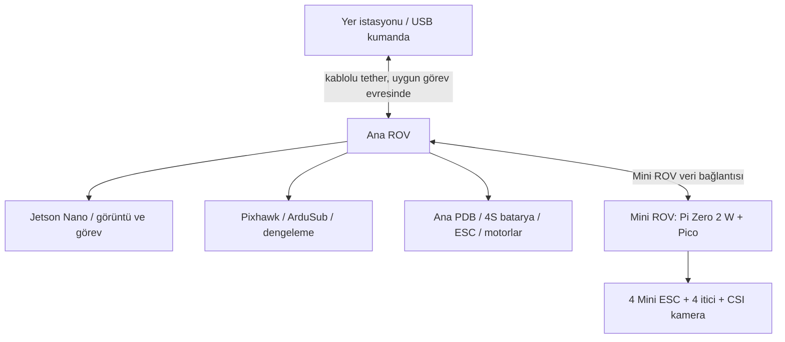

# Proje haritası

## 1. Ne yapıyoruz?
**ÇELEBİ–UMMAN** iki araçlı sistem: ana su altı aracı + boru inceleme için Mini ROV. 2026 raporlarında ana araç **6 iticili**, mevcut çalışma konuşmalarında **8 iticiye geçiş tasarlanıyor**. Bu iki konfigürasyonu birleştirip sanki üretilmiş tek araçmış gibi anlatmayın.

Önce [revizyon 2 kalite kontrolünü](KONTROL-RAPORU-2026-11-09.md) ve [kaynak–kanıt tablosunu](../01-Kaynaklar/KANIT-VE-KAYNAK-ESLESTIRMESI.md) inceleyin.

## 2. Bilgi alanları

> [!TIP] [Görsel atlas](../98-Gorseller/GORSEL-ATLAS.md) ve [sohbet diyagramları](../98-Gorseller/SOHBET-GORSELLERI.md) ile kaynakları inceleyin; [mimari akış](../02-Sistem/GORSEL-MIMARI.md) motor/sensör ilişkilerini açıklıyor.

| Alan | Giriş | Kanıt |
|---|---|---|
| Görevler ve 2026 kuralları | [2026-SARTNAME-VE-SORU-CEVAP](../01-Kaynaklar/2026-SARTNAME-VE-SORU-CEVAP.md) | 2026 PDF ve resmî SSS derlemesi |
| Ana araç elektroniği | [ELEKTRIK-ANA-SEMA](../03-Elektronik/ELEKTRIK-ANA-SEMA.md) | BOM + KTR; **netlist doğrulanmamış** |
| Mini ROV | [MINI-ROV](../02-Sistem/MINI-ROV.md) | MiniROV yazılım KTR, BOM |
| Kör uçuş | [KOR-UCUS-MIMARISI](../04-Yazilim/KOR-UCUS-MIMARISI.md) | Araştırma + tasarım, henüz tam sistem değil |
| Mevcut GitHub kodu | [GITHUB-KOD-DENETIMI](../04-Yazilim/GITHUB-KOD-DENETIMI.md) | isas-rov/ISAS-yazilim main |
| Mekanik | [SEKIZ-MOTORLU-SASE](../05-Mekanik/SEKIZ-MOTORLU-SASE.md) | Yeni öneri, ölçüler belirsiz |
| Sorun kayıtları | [SORUN-KAYDI](../06-Sorunlar/SORUN-KAYDI.md) | Geçmiş sohbet notları ve kaynaklar |
| Test | [TEST-STRATEJISI](../07-Test/TEST-STRATEJISI.md) | Taslak ve kanıt talebi |

## 3. Bilgi disiplini
1. Her parça için `planlanan / satın alınan / elde fiziksel var / test edildi` durumları ayrı tutulur.
2. Her şema en azından elektriksel fonksiyon, gerilim, koruma, arayüz, konnektör, ölçülen kanıt ve güvenlik açısından açıklanır.
3. Projenin **2026 yarışma dosyası** gelecekteki şartnamenin yerine geçmez.
4. Hiçbir `KTR` cümlesi tek başına gerçek test kanıtı değildir.
