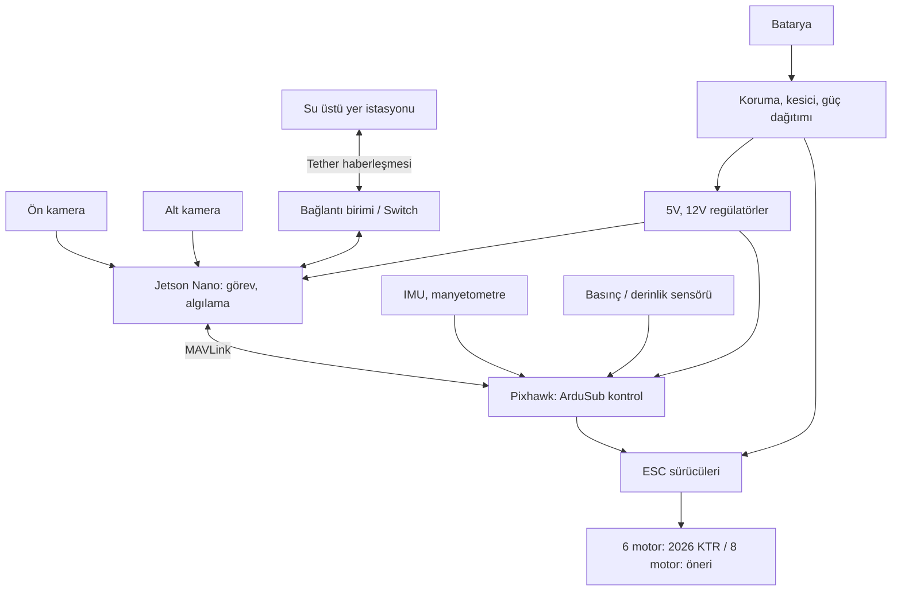
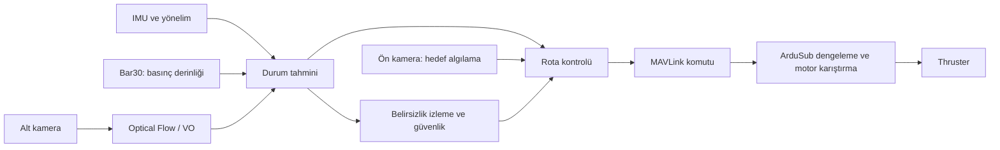
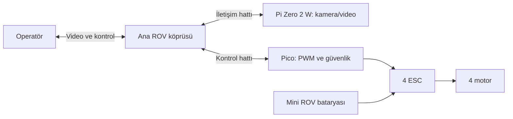

# Sistem akışları (kavramsal)

> [!WARNING] Üretim ve pin şeması değil
> Aşağıdaki çizimler **işlevsel blok şemalarıdır**. Bağlantı pini, kablo kesiti, sigorta değeri ve ESC beslemesi doğrulandıktan sonra nihai KiCad şemasına dönüştürülür. [Güncel KiCad kaynakları](https://github.com/isas-rov/isas-hardware/tree/main/electrical/kicad/main-rov) ayrı depodadır.

## Ana araç veri ve güç akışı

## Kör uçuşta bilgi zinciri

**Ana sınırlama:** Bar30, kamera–taban irtifasını vermez; optik akışın metrik ölçeği bundan dolayı her zaman hesaplanamaz. Alt kamera başarısızsa yatay konum kestirimi hızla belirsizleşir. [Ayrıntı](../04-Yazilim/OPTICAL-FLOW-VE-VO.md).

## Mini ROV ilişkisi

**Kontrol:** Mini ROV güç, toprak, haberleşme ve güvenlik kablo/topoloji kararları henüz fiziksel olarak doğrulanmalı. [Mini ROV](MINI-ROV.md).

## İlgili kaynaklar
- [Kavramsal bağlantı listesi](../03-Elektronik/BAGLANTI-TABLOSU.md)
- [Güncel KiCad taslağı](https://github.com/isas-rov/isas-hardware/tree/main/electrical/kicad/main-rov)
- [Görsel kaynak atlası](../98-Gorseller/GORSEL-ATLAS.md)
