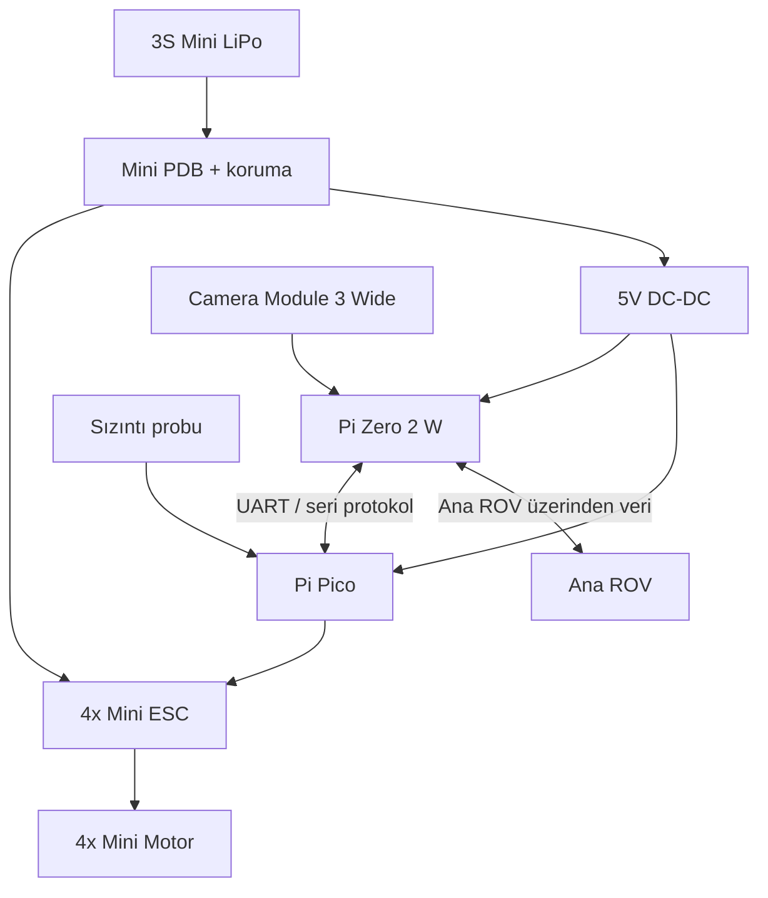

# Mini ROV sistem kartı

**Kaynaklar:** `MiniROV_Yazilim_KTR_v2.pdf` ve güncel BOM ana gider satırları 19–30. Bunlar satın alınma ve su altında çalışır test kanıtı değildir.

| Modül | Belgelenen model/adet | Görev |
|---|---|---|
| SBC | Raspberry Pi Zero 2 W ×1 | CSI kamera, video akışı, ana araca veri |
| Mikrodenetleyici | Raspberry Pi Pico ×1 | UART komutu, 4 ESC PWM, arıza/güvenlik |
| Kamera | Pi Camera Module 3 Wide ×1 | Boru içi görüntü / ipucu okuma |
| Mini motor | 3750 sınıf su geçirmez BLDC ×4 | İtki, gerçek model doğrulaması gerekli |
| Mini ESC | çift yönlü 30A ×4 | Dönüş kontrolü |
| Batarya | 3S 5000 mAh LiPo ×1 | Mini güç |
| PDB | Özgün Mini PDB ×1 | Güç dağıtımı |
| DC-DC | MP1584EN ve/veya UBEC | 5V elektronik besleme; yüke uygunluğu ölçülecek |
| Sızıntı | Probu ×1 | Su girişinde güvenli durum |
| Işık | Su altı feneri ×1 | Dar boruda kamera görüşü |

## Mantıksal bağlantı

## Kontrol / hata protokolü
Komut paketleri için sıra numarası, zaman aşımı, CRC, nötr motor davranışı, bağlantı kaybı ve güvenli arıza durumu tanımlanmalı. Taslaktaki CRC8 deneylerini uygulanmış sanma; test kaydı gerekir.

## Tartışmalı tasarım kararları
- Manyetik tut-bırak eski planı ile yeni servo mandal/kızak alternatifi açık; güç kesilince bırakma davranışı için FMEA gerekli.
- Mini ROV kablosu için veri protokolü, kesit, çekme emniyeti ve sızdırmazlık ayrı doğrulama gerektirir.
- Kamerayı tek başına döner muhafaza yapmak yerine sabit pencere arkasında pan/tilt mekanizması değerlendirilir.
