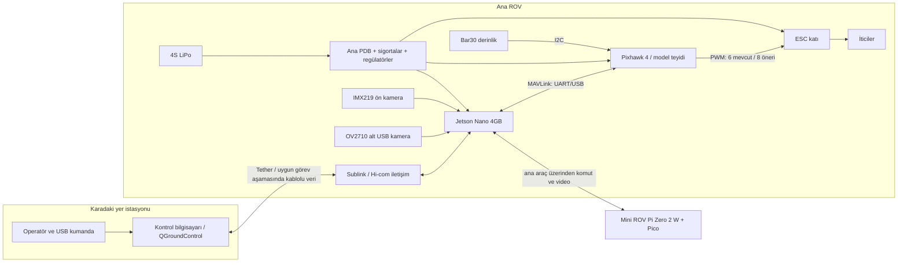

# Ana sistem mimarisi

**Belgesel temel:** 2026 KTR, TYF ve güncel BOM; **öneri:** sekiz iticili gövde ve VO tabanlı kör uçuş.

**Elektriksel şema değil:** konektör pinleri, gerilim ve akım değerleri üretici parça numaraları ile doğrulanmadan bağlanmaz. [ELEKTRIK-ANA-SEMA](../03-Elektronik/ELEKTRIK-ANA-SEMA.md).

## Veri yolları
1. **Ana görev:** Jetson; ön/alt kamera, görsel işleme, görev durumu ve navigasyon.
2. **Alt kontrol:** Pixhawk/ArduSub; IMU, derinlik, motor karıştırma ve motor sinyalleri.
3. **Mini ROV:** Pi Zero 2 W CSI video; Pico gerçek zamanlı ESC/sızıntı kontrolü. Haberleşmenin fiziksel ara birimleri ve dönüş kablosu teyit edilmelidir.
4. **Güç:** ana 4S batarya → ana sigorta/kesici → PDB → ayrı ESC ve regülatör kolları; Mini 3S batarya → Mini PDB → 4 ESC ve 5V regülatör.

## Görev bağımlılıkları
Kamera zemini görmüyorsa görsel odometri zayıflar; pusula motor akımından etkilenebilir; bu durumda hedef koordinatlı kör uçuşun doğruluğu garanti edilemez. [KOR-UCUS-MIMARISI](../04-Yazilim/KOR-UCUS-MIMARISI.md).
