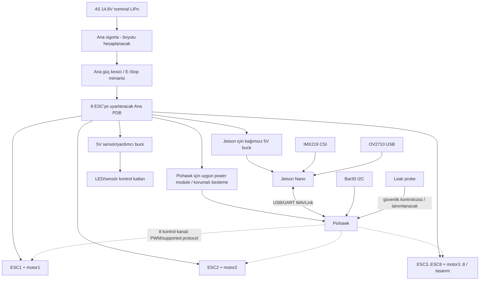

# Ana araç elektrik mimarisi — kavramsal şema

> **ÖNEMLİ:** Bu dosya **fabrikasyona hazır KiCad elektrik şeması değildir**. Motorların, regulatorların, konnektörlerin gerçek pin numaraları mevcut kaynaklardan kesinleştirilemez. Şema, hata/eksik kontrolü için işlevsel topolojidir; enerjileme öncesi KiCad/ERC/DRC, kablo kesiti, sigorta ve üretici pinout doğrulaması şart.

## Net sınıfları
- `VBAT_MAIN` — batarya artı hattı; ana sigorta ve anahtar sonrası dağıtım.
- `GND_MAIN` — güç dönüş hattı; sinyal referansları kontrollü bağlanacak; yıldız topraklama her durumda tek çözüm sayılmaz.
- `5V_JETSON` — Jetson Nano'nun modül/taşıyıcı girişine uygun gerilim ve akım; 3A LM2596 üzerine kör bağlamayın.
- `5V_AUTOPILOT` — Pixhawk'a üretici tasarımına göre power-module/porttan besleme.
- `5V_AUX` — sensör/yardımcı; özellikle motor hatlarının anahtarlama gürültüsünden ayırma/filtreleme.
- `PWM_MOT_1...8` — Pixhawk'ın **teyit edilen** çıkışlarından ESC'lere; arayüz pinout üreticiden kontrol edilecek.
- `I2C_BAR30` — kısa 3.3V lojik düzeyi, kablo ve konnektör sürümü dikkat.
- `UART_MAVLINK` — TX-RX çapraz bağlantı, ortak referans ve 3.3V/5V seviyeleri doğrulanmalı.

## Kablosuz bağlantı yok varsayımı
2026 tam otonom görevinde yüzeyden canlı görev komutuna dayanılmamalı; tether'ın mekanik emniyet görevi ve kablolu operatör evreleri görev bazında ayrılır.

## Çok önemli eksikler
1. Toplam / tepe akım, sigorta seçimi, PDB iz kalınlığı ve kablo AWG hesapları.
2. ESC'lerin su altında ısı atımı, epoksi uyumluluğu ve sızdırmazlık.
3. Batarya terminali, güç kesicinin açma kapama davranışı ve Mini ROV'a etkisi.
4. Pixhawk 4 ve Pixhawk 2.8 arasında konnektör/port farkları.
5. Harici pusula beslemesi, veri hattı ve manyetik çevre.
6. E-stop donanımının gerçek fail-safe davranışı.

Bak: [BAGLANTI-TABLOSU](BAGLANTI-TABLOSU.md) • [GUC-BATARYA-PDB](GUC-BATARYA-PDB.md) • [EMI-PUSULA](EMI-PUSULA.md)
