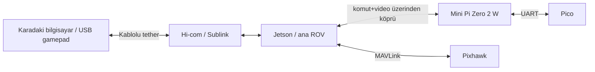

# Yer istasyonu / tether / Mini ROV veri yolu

2026 mimarisinde yer istasyonu → ana ROV ve Mini ROV → ana ROV → yer istasyonu kablolu veri zinciri belgelenmiştir.

## Yetersiz tanımlı parçalar
- `Sublink` ve `Hi-com` kalemleri farklı modüller; **iki cihaz arasında uyumluluk** ve port türleri ölçülerek belgelenecek.
- Ethernet switch 5 port seçimi gerçek toplam port sayısına ve throughput'a göre yapılacak.
- Yüzeyde WiFi/anten gibi geçici bir seçenek resmî kurala alternatif sanılmamalı; 2026 cevabında kablolu bağlantı vurgulanmış.
- Mini–ana ROV kablo uzunluğu, mekanik gerilme ve bağlantı kopma kurtarma planı gerekli.
- Otonom görevde canlı komut/telemetri ile güvenlik halatı aynı işlev değil; mevzuat/şartnameye göre ayrılacak.

## Loglamak gerekenler
`packet_loss`, `latency_ms`, `stream_bitrate`, `crc_fail`, `heartbeat_age`, `tether_length_m`, `wet_connector_id`.
