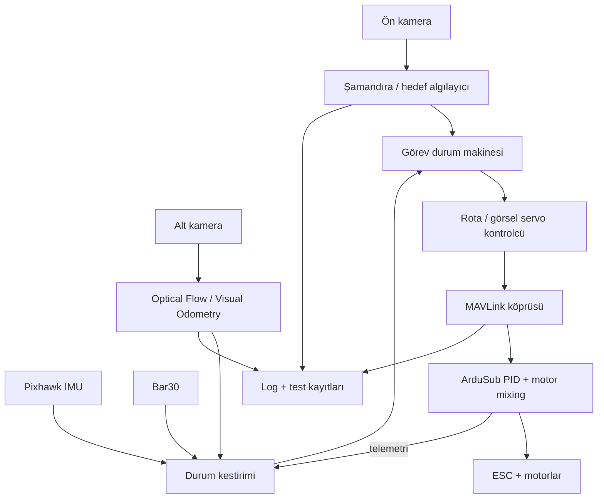

# Yazılım mimarisi — Jetson + Pixhawk

## Sorumluluk bölüşümü (kişilere değil **modüllere**)
- `camera/`: görüntü alma, kalibrasyon, zaman damgası.
- `vision/`: şamandıra/çizgi tespiti ve görsel güven skoru.
- `odometry/`: Optical Flow, VO ve ölçek belirsizliği.
- `estimation/`: IMU+derinlik+görsel ölçümlerin füzyonu.
- `navigation/`: rota, hedef ve sapma hesabı.
- `control/`: üst seviye konum/görsel servo kontrol; Pixhawk alt seviye PID'siyle kavga etmeme.
- `bridge/`: PyMAVLink/ArduSub telemetrisi, servis sağlık durumu, bağlantı kaybı.
- `logging/`: CSV/rosbag2/video senkron kayıt.

## Koordinat çerçeveleri
`map` (yerel parkur başlangıcı), `odom` (göreli ve drift içeren), `base_link` (araç), `camera_front` ve `camera_bottom`. MAVLink NED/FRD ile bilgisayar tarafında kullanılabilecek ENU/FLU arasında dönüşümler **belgelenmeden** dış odometri yayımlamayın.

## Neden ROS zorunlu değil?
Jetson Nano 4GB ilk prototipte Python+OpenCV+PyMAVLink çalıştırabilir. U-VIP-SLAM vb. ROS bağımlı araştırmalar önce masaüstünde oynatılır. Nano gerçek zaman / CPU/GPU RAM kısıtları test edilmeden modül seçilmez.
