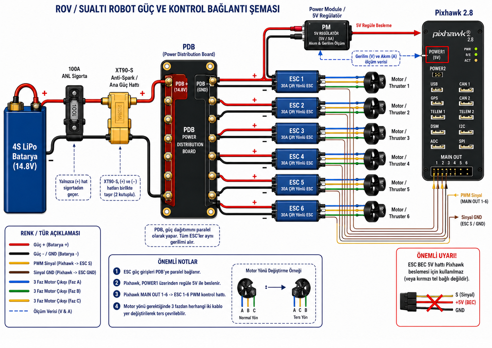
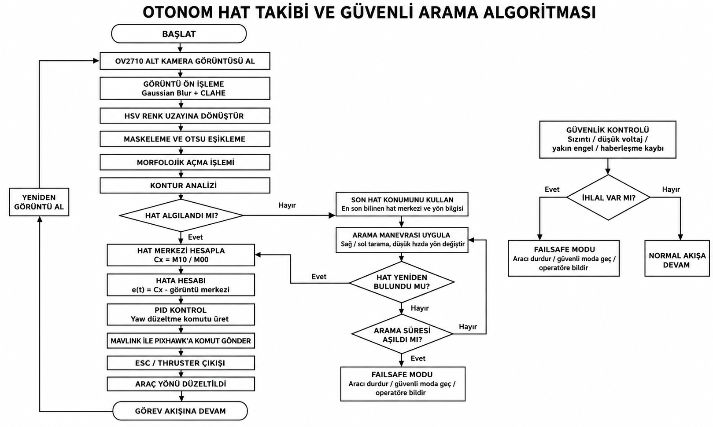
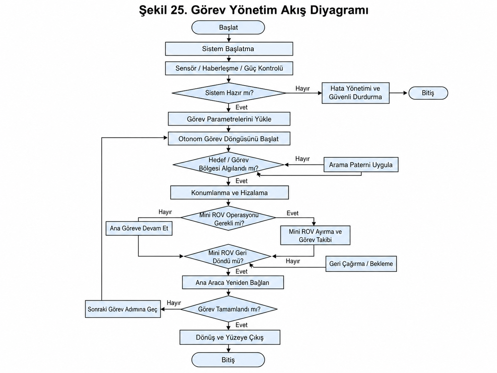

# ChatGPT sohbetlerinde üretilen teknik görseller

> [!IMPORTANT] Durum ve güvenlik
> Bu sayfadaki PNG'ler **sohbetlerde oluşturulan kavramsal anlatım görselleridir**. Gerçekte kurulmuş bağlantı, çalıştırılmış algoritma, test sonucu veya üretime uygun onaylı elektrik şeması oldukları kanıtlanmış değildir. Özellikle 6 motorlu şema yeni 8 motorlu araç tasarımının yerine geçmez. Bağlantı/elektrik kararları öncesinde [esas donanım deposundaki KiCad dosyaları](https://github.com/isas-rov/isas-hardware/tree/main/electrical/kicad) ve doğrulanmış parça özellikleri esas alınmalıdır.

[← Görsel atlas](GORSEL-ATLAS.md) · [Bilgi tabanı](../README.md) · [Elektrik mimarisi](../03-Elektronik/ELEKTRIK-ANA-SEMA.md) · [Yazılım mimarisi](../04-Yazilim/YAZILIM-MIMARISI.md)

## 1. Güç ve kontrol şeması — tarihsel 6 iticili çizim

**Görselde ne var?** 4S LiPo → sigorta → XT90-S → PDB → 6 ESC → 6 motor; Pixhawk 2.8 ve power module bağlantı yaklaşımı.

**Dikkat:** Görseldeki **100 A sigorta, güç modülü, PDB akım kapasitesi, ESC BEC ayırma notları, kablo kesitleri ve pin dizilimi** yalnızca şemadaki önerilerdir; ölçüm/üretici datasheet/gerçek montaj ile doğrulanmadan uygulanmaz. Özellikle farklı 6/8 motor konfigürasyonlarının akım bütçesi yeniden hesaplanmalıdır. [Güncel şema inceleme ve güvenlik notu](../03-Elektronik/GUC-BATARYA-PDB.md).

**Kaynak:** `CELEBI_UMMAN_Gorsel_Arsivi_Kismi.zip` içindeki `gorseller/guc-ve-kontrol-semasi.png`.

## 2. Otonom hat takibi ve güvenli arama — algoritma taslağı

**Görselde ne var?** Alt kamera → görüntü iyileştirme → renk/eşik → kontur → hat merkezine göre hata → PID yön düzeltmesi → MAVLink komutu; hat kaybında arama ve güvenlik denetimi.

**Dikkat:** Bu görsel, repo kodunda tüm adımların uygulanıp Pixhawk'a bağlı olduğu anlamına gelmez. Algılama, motor kontrolü ve güvenlik modları için ayrı test kanıtı gereklidir. [Yazılımın mevcut durumu](../04-Yazilim/GITHUB-KOD-DENETIMI.md).

**Kaynak:** `gorseller/otonom-hat-takibi-guvenli-arama.png`.

## 3. Görev yönetim akış diyagramı — operasyon taslağı

**Görselde ne var?** Hazırlık kontrolleri, görev parametreleri, hedefe intikal, Mini ROV ayrılma/görev/yeniden bağlanma akışı, sonraki görev ve emniyetli bitiş.

**Dikkat:** Mini ROV'un **geri dönüş/yeniden bağlanma** adımları fiziksel olarak doğrulanmış bir mekanizma değildir. 2026 görev koşulları ve yeni sezon şartnamesine göre görev durum makinesi ayrıca doğrulanmalıdır. [Mini ROV kavramı](../02-Sistem/MINI-ROV.md).

**Kaynak:** `gorseller/gorev-yonetim-akis-diyagrami.png`.

## 4. ZIP envanteri ve erişilemeyen görseller

Kaynak ZIP'in `manifest.json` dosyasında **5 görsel** kayıtlıdır. ZIP'ten elde edilen **3 orijinal PNG** yukarıya değiştirilmeden aktarıldı; SHA-256 değerleri orijinal manifest ile eşleştirildi. Aşağıdaki **2 görselin baytları ZIP'te yoktur**, dolayısıyla yeniden üretildi veya GitHub'a eklendi iddiası yapılmaz:

- `ana-arac-elektronik-semasi.png` — Ana Araç Elektronik Devre ve Blok Diyagramı; manifest kaynağı: ChatGPT Library `/Umman-KTR`
- `jetson-pixhawk-baglanti-semasi.png` — Jetson Nano–Pixhawk Bağlantı Şeması; manifest kaynağı: ChatGPT Library `/Jetson`

[Kaynak ZIP ve orijinal PNG'lerin Drive klasörü](https://drive.google.com/drive/folders/1kAcrS5qfPCZDV5Op6wNRkgH8xQ3vrRB4) · [Kaynakların kapsamı](GORSEL-KAYNAKLAR-VE-IZINLER.md).

| Dosya | SHA-256 |
|---|---|
| `guc-ve-kontrol-semasi.png` | `7307b168cc0e7d385af506c933c51e5a7ff6eb1bf14119802b6d8279668a5615` |
| `otonom-hat-takibi-guvenli-arama.png` | `838b87947ca15ef8dfc050af14907516e455b9825bd017a20efce316b415d1ba` |
| `gorev-yonetim-akis-diyagrami.png` | `8f2c3fb584259c489a9c93bc60ea243acaa826b156a5b7ed66a6f22d019331c9` |
